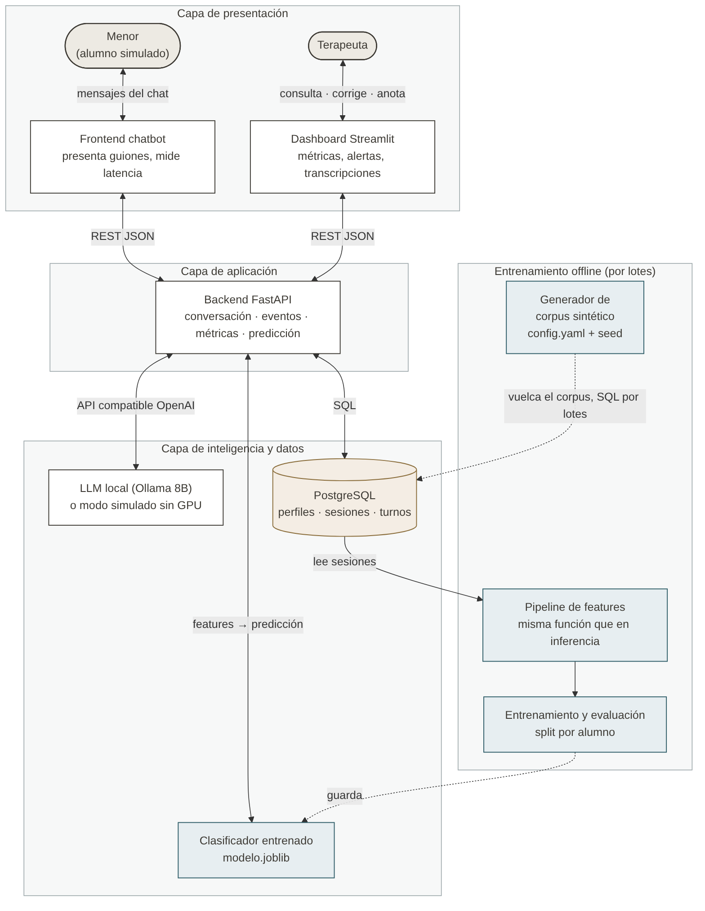

# SOCIAL-SIM Chat

Entrenador conversacional y learning analytics para menores con TEA/Asperger (6-12 años).

Proyecto del Módulo C088 · Proyecto de Inteligencia Artificial y Big Data · Curso 2026–2027.

## Objetivo

Construir un entrenador conversacional con IA local que practique habilidades pragmáticas (metáforas, sarcasmo, deixis, preguntas) con el menor, registre cada interacción y ofrezca al terapeuta un panel con alertas tempranas de estancamiento. Todo el dato se procesa en local, sin nube.

El prototipo trabaja exclusivamente con **datos sintéticos**: valida que el sistema funciona de extremo a extremo, no su validez clínica.

## Equipo

- Álvaro García Puche — Dominio pedagógico, datos y dashboard
- Marcos Expósito Flox — Plataforma e ingeniería ML

## Arquitectura resumida



El sistema se organiza en cuatro bloques:

- **Presentación.** El menor conversa en el frontend del chatbot, que presenta los guiones y mide la latencia de cada respuesta. El terapeuta consulta, corrige y anota en un dashboard de Streamlit.
- **Aplicación.** Un backend en FastAPI gestiona la conversación, registra cada turno como evento, calcula las cinco métricas de la sesión y pide la predicción al clasificador. Frontend y dashboard se comunican con él por REST/JSON.
- **Inteligencia y datos.** Un LLM local (Ollama, 8B) genera las réplicas del personaje, con un modo simulado para trabajar sin GPU. PostgreSQL guarda perfiles, sesiones y turnos. El clasificador entrenado (`modelo.joblib`) predice si cada sesión es progreso, estancamiento o regresión.
- **Entrenamiento offline.** El generador de corpus sintético (`config.yaml` + semilla) produce las sesiones de entrenamiento. El pipeline de features, la misma función que se usa en inferencia, calcula la ventana de las últimas 4 sesiones, y el modelo se entrena y evalúa separando por alumno.

El terapeuta recibe una alerta cuando el clasificador predice estancamiento o regresión en 3 sesiones consecutivas. El modelo de datos está en [`docs/er.png`](docs/er.png) y el detalle completo, en el documento de NF2 de `docs/`.

## Stack

Python · FastAPI · Ollama (LLM local) · PostgreSQL · scikit-learn · Streamlit · Docker Compose

## Organización del repositorio

```
docs/          Documentación del proyecto, entregas y diagramas
  adr/         Registro de decisiones de arquitectura
src/           Código fuente
  generador/   Generador del corpus sintético
  ml/          Features, entrenamiento y evaluación del clasificador
data/          Datos sintéticos generados (no se versionan)
reports/       Informes de evaluación (informe_metricas.json)
environment/   docker-compose y .env.example
tests/         Tests automáticos
config.yaml    Parámetros del generador y de las features
```

## Cómo ejecutarlo

El sistema completo está en construcción: el objetivo es que se levante con un solo comando (`docker compose up`) e incluya un modo de LLM simulado para ejecutarlo sin GPU.

Lo que ya funciona es el corpus sintético y la evaluación del clasificador (Python 3.10 o superior), desde la raíz del repositorio:

```bash
pip install numpy pandas pyyaml scikit-learn

# Generar el corpus (misma semilla, mismo corpus)
python src/generador/generador_corpus_sintetico.py

# Evaluar el clasificador y las comprobaciones antifuga (unos 5 minutos)
python src/ml/evaluar_corpus.py --semillas 10 --barrido-ruido 0.01 0.02 0.03 0.05 0.07
```

El corpus se escribe en `data/corpus_sintetico/` y el informe, en `reports/informe_metricas.json`.

> Corpus sintético: las métricas miden si el modelo aprende los patrones programados por el equipo, no eficacia clínica. Los casos ambiguos y el ruido están puestos a propósito.

## Forma de trabajo

- Nada se sube a `main` sin pull request revisada por el otro miembro.
- Cada tarea tiene una issue asignada.
- Las decisiones técnicas relevantes se documentan en `docs/adr/`.

## Estado

- NF1 — Presentación y viabilidad (entregado 22/09/2026).
- NF2 — Diseño, datos y planificación (entrega 14/10/2026): arquitectura, modelo de datos, generador del corpus y criterio de éxito del clasificador cerrados.
- NF3 — Desarrollo, integración y validación (15/10–12/11/2026): siguiente fase.
